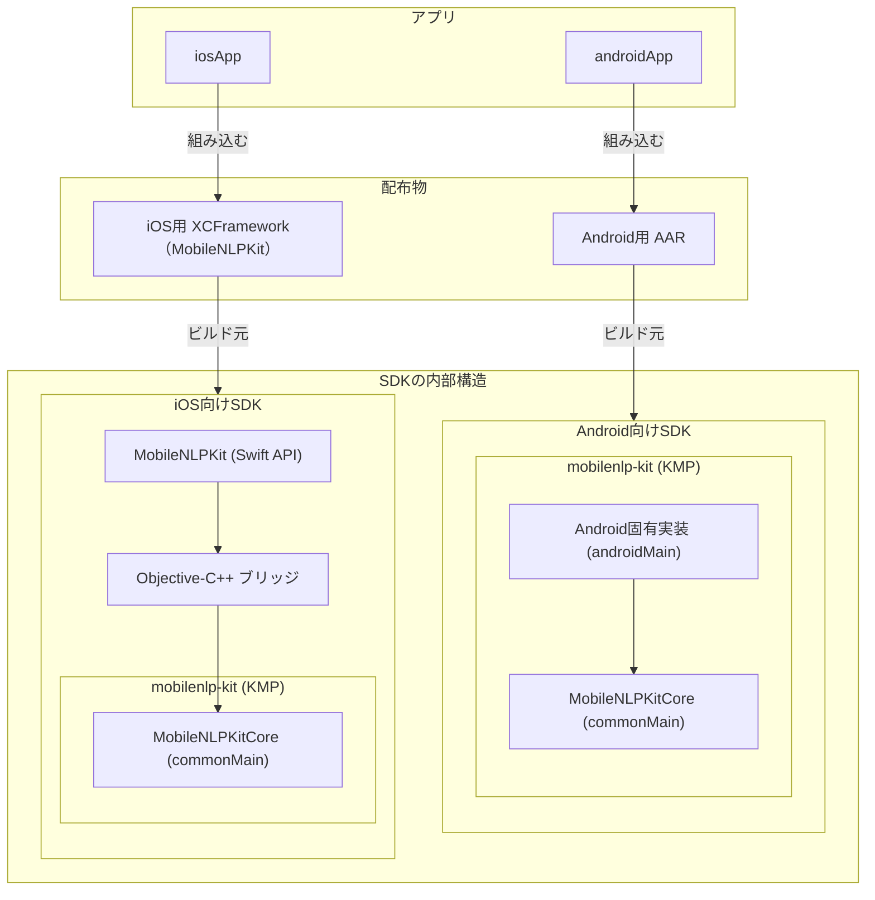
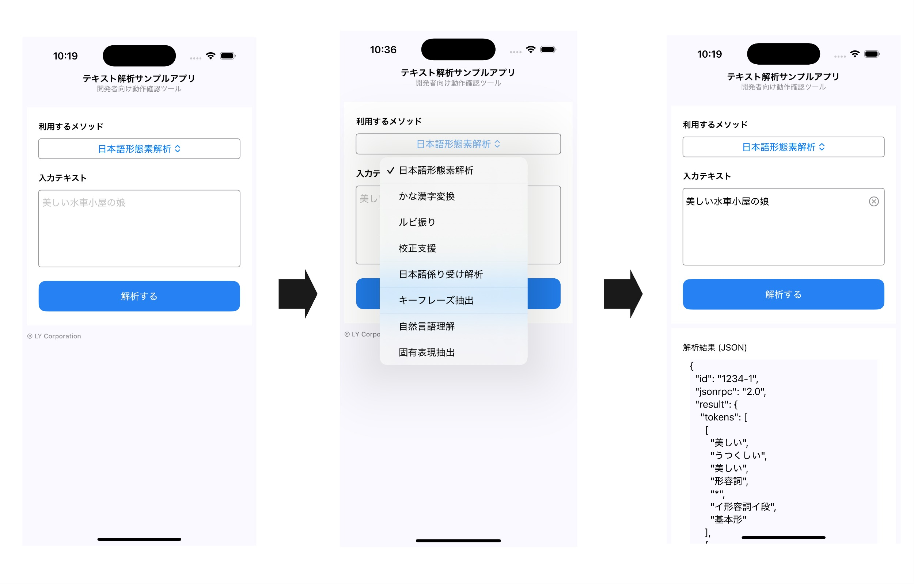

[](./LICENSE)

# LY Corporation Mobile NLP SDK

LY Corporation Mobile NLP SDK は、モバイル端末上で動作するアプリ内で自然言語解析処理を手軽に利用できるようにすることを目的とした SDK です。

現在はその手段のひとつとして、**Yahoo!デベロッパーネットワーク（YJDN）** が提供するテキスト解析 Web API を **Android/iOS** アプリ上から簡単に利用できる実装を提供しています。

## 特長

- **クロスプラットフォーム**: Android は `.aar`、iOS は `.xcframework` を提供
- **最小限のセットアップ**: APPID を設定するだけで API 呼び出しを開始
- **デモ同梱**: 導入・実行手順を確認できるデモアプリを同梱（導入手順にはデモアプリの例が含まれていますが、利用者のアプリに組み込むことを目的としています）

## 本 SDK で利用可能なテキスト解析 WebAPI の機能

| 機能               | リクエストパラメータの method  |
| ------------------ | ------------------------------ |
| 日本語形態素解析   | `jlp.maservice.parse`          |
| かな漢字変換       | `jlp.jimservice.conversion`    |
| ルビ振り           | `jlp.furiganaservice.furigana` |
| 校正支援           | `jlp.kouseiservice.kousei`     |
| 日本語係り受け解析 | `jlp.daservice.parse`          |
| キーフレーズ抽出   | `jlp.keyphraseservice.extract` |
| 自然言語理解       | `jlp.nluservice.analyze`       |
| 固有表現抽出       | `jlp.nerservice.extract`       |

詳細は[テキスト解析 WebAPI のドキュメント](https://developer.yahoo.co.jp/webapi/jlp/)をご覧ください。

## プロジェクト構成



## サポート環境

| Platform | Minimum OS           | Target OS             | Toolchain                              |
| -------- | -------------------- | --------------------- | -------------------------------------- |
| Android  | API 24 (Android 7.0) | API 36 (Android 16.0) | Kotlin 2.3.10 / JDK 17 / Gradle 8.10.2 |
| iOS      | iOS 15               | iOS 26.2              | Xcode 26 / Swift 5.10                  |

> **Note**: 上記は検証済みの推奨構成です。その他の組み合わせは動作を保証しません。

## 導入方法

### APPID の発行（必須）

Yahoo! JAPAN の Web API を利用するには、アプリケーションごとに発行される **アプリケーション ID（APPID）** が必要です。以下の手順で発行してください。

1. https://e.developer.yahoo.co.jp/register にアクセス
2. Yahoo! JAPAN ID でログイン
3. 「新しいアプリケーションを開発」で必要事項を入力
4. 登録完了後、APPID が発行されます

APPID の詳細については、[こちらのサポート記事](https://support.yahoo-net.jp/PccDeveloper/s/article/H000006122)をご覧ください。

### Android

#### 1. AAR の生成

本リポジトリのルートディレクトリで以下を実行してください。

```console
$ ./gradlew :mobilenlp-kit:assemble
```

生成先は `mobilenlp-kit/build/outputs/aar/mobilenlp-kit-{debug,release}.aar` です。

```console
$ ls -L1 mobilenlp-kit/build/outputs/aar/
mobilenlp-kit-debug.aar
mobilenlp-kit-release.aar
```

#### 2. AAR の読み込み

##### 利用者のアプリでの設定

導入先モジュール（`<module_root>`）に `libs` ディレクトリを作成し、生成した `.aar` ファイルを配置してください。

```console
# 例: リリース版の AAR を配置する場合
$ mkdir -p <module_root>/libs
$ cp mobilenlp-kit/build/outputs/aar/mobilenlp-kit-release.aar <module_root>/libs/
```

続いて、導入先モジュールの `build.gradle.kts` に以下を追記して、Gradle への依存関係を追加してください。

```kotlin
dependencies {
    // for mobilenlp-kit
    implementation(files("libs/mobilenlp-kit-release.aar"))

    // SDK が利用する依存ライブラリ
    // ※ 利用者側で確認して追加してください
}
```

本 SDK は、ネットワーク通信や JSON 解析などに外部ライブラリを利用しています。
これらのライブラリは SDK に同梱されないため、利用者のアプリ側で追加が必要です。

どのライブラリが必要かは、以下のコマンドで確認してください。

```console
$ ./gradlew :mobilenlp-kit:dependencies --configuration releaseRuntimeClasspath | grep -E '^(\+|\\)--- '
```

出力例:

```console
+--- io.ktor:ktor-client-okhttp:3.2.1
+--- org.jetbrains.kotlin:kotlin-stdlib:2.3.10 (*)
+--- io.ktor:ktor-client-core:3.2.1 (*)
+--- org.jetbrains.kotlinx:kotlinx-serialization-json:1.8.1
\--- org.jetbrains.kotlinx:kotlinx-coroutines-core:1.10.2 (*)
```

この場合、`kotlin-stdlib` を除いた以下の依存を追加する必要があります。

```console
implementation("io.ktor:ktor-client-okhttp:3.2.1")
implementation("io.ktor:ktor-client-core:3.2.1")
implementation("org.jetbrains.kotlinx:kotlinx-serialization-json:1.8.1")
implementation("org.jetbrains.kotlinx:kotlinx-coroutines-core:1.10.2")
```

⚠️ 依存ライブラリやバージョンは SDK の更新により変わる可能性があります。
プロジェクトに組み込む際は、必ず上記コマンドで最新の依存関係を確認してください。

さらに、ネットワーク通信を行うためには `AndroidManifest.xml` に以下のパーミッションを追加してください。

```xml
<uses-permission android:name="android.permission.INTERNET"/>
```

##### デモアプリ（androidApp）

本リポジトリに含まれるデモアプリ（androidApp）では、mobilenlp-kit モジュールを直接依存関係に含めています。
そのため、デモアプリをビルドする際には `.aar` を `libs/` に配置する必要はありません。

### iOS

#### 1. xcframework の生成

本リポジトリのルートディレクトリで以下を実行してください。

```console
$ ./gradlew :mobilenlp-kit:assembleMobileNLPKitCoreXCFramework
```

生成先は `mobilenlp-kit/build/XCFrameworks/{debug,release}/MobileNLPKitCore.xcframework` です。

```console
$ ls -L1 mobilenlp-kit/build/XCFrameworks/*/*.xcframework
mobilenlp-kit/build/XCFrameworks/debug/MobileNLPKitCore.xcframework:
Info.plist
ios-arm64
ios-arm64-simulator

mobilenlp-kit/build/XCFrameworks/release/MobileNLPKitCore.xcframework:
Info.plist
ios-arm64
ios-arm64-simulator
```

#### 2. xcframework の読み込み

> **Note**: iOS 向け SDK 本体は **MobileNLPKit** で、内部で `mobilenlp-kit` の **commonMain** を利用します。

> ⚠️ アプリでの利用には `MobileNLPKitCore` と `MobileNLPKit` の両方が必要です。

##### 利用者のアプリでの設定

Swift Package Manager（SPM）経由で `MobileNLPKit` を追加してください。

1. Xcode でアプリのプロジェクトを開く
2. 「PROJECT > Package Dependencies > ＋」 を開く
3. 「Add Local」を選択してこのリポジトリの `Package.swift` を指定する
4. 「Frameworks, Libraries, and Embedded Content」に `MobileNLPKit` を追加する

##### デモアプリ（iosApp）

本リポジトリ内のデモアプリは、生成した `MobileNLPKit.framework` を直接参照しています。
そのため、iosApp をビルドする際に SPM の追加設定を行う必要はありません。

## 使い方

### Android (Kotlin)

```kotlin
import jp.co.lycorp.jlp.mobilenlp.kit.JlpHandlerType
import jp.co.lycorp.jlp.mobilenlp.kit.MobileJlpHandlerFactory
import jp.co.lycorp.jlp.mobilenlp.kit.model.JlpMethod
import kotlinx.coroutines.runBlocking

viewModelScope.launch(Dispatchers.IO) {
    // 1) ハンドラ作成
    val handler = MobileJlpHandlerFactory.create(JlpHandlerType.Online("<APPID>"))

    // 2) 解析（suspend）
    val response = handler.analyze(JlpMethod.MA, "美しい水車小屋の娘", id = "1234-1")

    // 3) 出力
    println(response)
}
```

### iOS (Swift)

```swift
import MobileNLPKit

// 1) ハンドラ作成
let handler = MobileJlpHandlerFactory.create(JlpHandlerType.online(appid: "<APPID>"))

// 2) 解析（async）
let response = await handler.analyze(method: .ma, query: "美しい水車小屋の娘", id: "1234-1")

// 3) 出力
print(response)
```

### バージョン差異

⚠️ **iOS API の非同期化（v1.2.0 以降）**

iOS の `analyze` は、v1.2.0 以降 `async` 関数になりました。呼び出し時には `await` が必要です。また、呼び出し元は `async` 関数または `Task` 内で実行してください。

```swift
// v1.1.0 以前
handler.analyze(method: .ma, query: "美しい水車小屋の娘", id: "1234-1") { jlpResponse, _ in
    if let response = jlpResponse {
        print(response)
    }
}

// v1.2.0 以降
let response = await handler.analyze(method: .ma, query: "美しい水車小屋の娘", id: "1234-1")
print(response)
```

## デモアプリの利用

### APPID の設定

[こちら](#appid-の発行必須)で発行した APPID は、デモアプリで利用するために `secrets.properties` に以下のように記載してください。

```console
$ cat secrets.properties
appid=your_appid_here  # 発行された APPID をここに記載
```

### ビルドと実行

#### Android

1. Android Studio でプロジェクトを開く
2. Run Configuration を `androidApp` に設定して実行

#### iOS

1. `iosApp/JlpTestApp.xcworkspace` を Xcode で開く
2. ターゲットを `iosApp` に設定し、シミュレータまたは実機で実行

> **Note**: Gradle がサポートする Java バージョンには上限があるため、システムのデフォルト JDK がサポート範囲を超えているとビルドエラーとなることがあります。  
> その場合はリポジトリルートに `.xcode.env` を作成し、`JAVA_HOME` を固定してください。  
> このファイルが存在する場合、`MobileNLPKit.xcodeproj` の "Build KMP Framework" Run Script フェーズの実行前に自動で読み込まれます。
>
> ```sh
> export JAVA_HOME=$(/usr/libexec/java_home -v 17)
> export PATH="$JAVA_HOME/bin:$PATH"
> ```

### デモアプリの使い方

1. 利用するメソッド（例：日本語形態素解析）を選択
2. 「入力テキスト」に自然文を入力（デフォルトでサンプルテキストが入力済み）
3. 「解析する」ボタンを押下
4. JSON 形式の結果が画面下部に表示されることを確認



## ライセンス

本プロジェクトのライセンスファイルは[こちら](LICENSE)からご覧いただけます。
